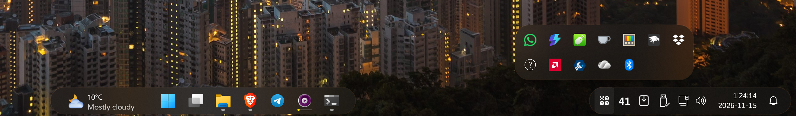

# Custom DockLike Theme for Windhawk's Windows 11 Taskbar Styler Mod

I had a theme based on the built in DockLike theme, but every other time the mod updated, there would be theme breaking changes, so for a while, I ran forks, maintaining my customised DockLike them in every build. I eventually tired of this, so I built this theme from the ground up, and it doesn't depend on any of the built in themes, so it should be resilient to updates.

To use, just open the Settings tab of the Windows 11 Taskbar Styler, press the button to go into Text Mode, and paste the contents of the YAML file into the text box. You can then switch back to visual mode, and easily tweak any of the style constants to your liking - fill and border colours and opacity, systray icons per row, systray icon size etc.

I hope that you enjoy!

